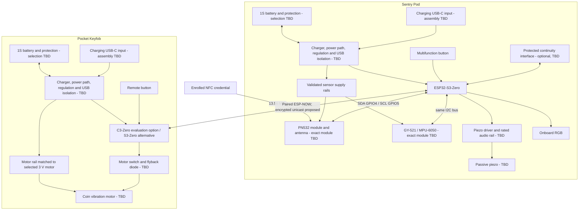

# Dual-Auth Cafe Sentry - System Architecture

Revision: 0.1 | Date: 2026-11-11 | Status: design basis for independent review

**Not a released schematic, PCB, enclosure design, or manufacturing approval.**
The complete [project specification](../PROJECT_SPEC.md) and
[engineering instructions](../AGENTS.md) govern this package. Neither has been
changed. No PCB or CAD files were created for this task.

## 1. Package control and evidence

| Document | Responsibility |
| --- | --- |
| [Architecture](architecture.md) | System partition, behavior, communications, source index |
| [Component register](component-register.csv) | Part identity, dimensions, evidence, outstanding verification |
| [Pinout](pinout.md) | GPIO allocation, logical connections, interface and unused-pin requirements |
| [Power architecture](power-architecture.md) | Charging, protection, power distribution and verification |
| [Mechanical requirements](mechanical-requirements.md) | Packaging, assembly, placement, dimensional feasibility |
| [Design decisions](design-decisions.md) | Baseline, proposals, owner approvals and revision history |
| [Engineering risks](engineering-risks.md) | Conflicts, consequences and closure evidence |
| [Development roadmap](development-roadmap.md) | Stages, dependencies, tests and release gates |

Evidence labels used throughout:

- **S - Specification:** a requested requirement, not a demonstrated capability.
- **V - Verified documentation:** supported by the identified manufacturer
  document; not a measurement of the eventual purchased assembly.
- **P - Proposal:** engineering recommendation, not an approved specification change.
- **TBD:** selection, value, implementation or evidence is still missing.

Manufacturer IC data must not be substituted for breakout-board data. Published
nominal outlines must not be treated as tolerance-controlled assembly envelopes.
Reference-only parts in the register are **not selected substitutions**.

## 2. System boundary and unit separation

**S:** A phone-free, local anti-theft deterrent comprising two independently
battery-powered units. No phone, cloud service, Wi-Fi access point or Internet
connection is required during operation.

| Unit | Electrical architecture | Mechanical architecture |
| --- | --- | --- |
| Sentry Pod | ESP32-S3-Zero; shared I2C PN532 and MPU-6050/GY-521; passive piezo and driver; onboard RGB indication; one multifunction button; optional protected continuity tether; its own battery, charger, protection and regulated rails | Removable base and flat NFC-marked lid; NFC window; isolated battery compartment; supported electronics; acoustic vent; accessible controls/ports; reinforced carabiner attachment |
| Pocket Keyfob | ESP32-C3-Zero **or** ESP32-S3-Zero; button; coin-motor driver and flyback suppression; independent battery, charger, protection and regulated rails | Removable base/lid; motor-to-case coupling; battery restraint; accessible button, charging/service interfaces and keyring attachment |

**P:** Use the C3-Zero as the first Keyfob evaluation option. Keep the permitted
S3-Zero alternative until measured power and packaging results select one
([D-02](design-decisions.md#d-02)). Do not populate both.

The two units have no required wired signal or ground connection. ESP-NOW is the
inter-unit link. An NFC credential couples only to the Pod's 13.56 MHz antenna.
Charging and programming interfaces are separate from the tether function.

This is a functional diagram. Driver power, all returns, interrupt/reset lines,
USB details and conditional interfaces are enumerated in the
[connection schedule](pinout.md). A box marked TBD is not an approved circuit.

## 3. Electrical design basis

### 3.1 Sentry Pod

- **V:** Waveshare's S3-Zero uses ESP32-S3FH4R2, native USB, an ME6217C33M5G
  regulator, ceramic antenna and GPIO21 RGB control
  ([SRC-01](#src-01), [SRC-02](#src-02)).
- **S:** Preserve GPIO4/5 I2C, GPIO6 audio, GPIO7 button and GPIO8/9 optional
  tether. Additional reset, interrupt, battery-monitor and charge-status
  allocations are explicitly proposed in the [pinout](pinout.md).
- **V:** PN532 host I/O supply is 1.6-3.6 V; its battery supply range is
  2.7-5.5 V at the **IC**, not an arbitrary module connector
  ([SRC-09](#src-09), Table 1). The module's regulator, level translation,
  pull-ups, antenna and pin accessibility remain TBD.
- **V:** MPU-6050 VDD is 2.375-3.46 V; VLOGIC is 1.71 V to VDD and must not
  exceed VDD. Its package is nominally 4 x 4 x 0.9 mm, not the GY-521 board
  outline ([SRC-11](#src-11), sections 3, 6 and 7).
- **P:** Keep logic at a validated 3.3 V. Select sensor supply interfaces only
  after module schematics are known. Feeding 3.3 V into an unknown onboard
  regulator input can undervolt the IC; powering a module at 5 V can expose
  the shared bus to incompatible pull-ups.
- **TBD:** Audio rail, piezo, driver discharge/clamp network and all maximum
  currents. Neither a 2N2222 label nor a 1 kohm base resistor proves safe
  switching, adequate waveform amplitude or 105 dB output.

### 3.2 Pocket Keyfob

- **V:** C3-Zero uses ESP32-C3FH4, native USB, ME6217C33M5G and GPIO10 RGB
  control. Its V2 schematic powers the RGB LED from the 5 V net, unlike the
  S3 board's 3.3 V connection ([SRC-04](#src-04), [SRC-05](#src-05)).
- **S:** One button supports remote mute / panic intent; one 3 V coin motor
  supplies haptic feedback. Gesture mapping, mute scope and panic behavior
  require approval, particularly when the Pod is NFC force-locked.
- **P:** A rated motor rail and low-side transistor/driver, hardware off bias,
  local bypass/bulk capacitance and flyback diode. Do not connect a nominal
  3 V motor directly to an unspecified LiPo or USB rail.
- **TBD:** Actual motor voltage range, startup/stall current, duty limit,
  mounting adhesive, vibration strength and battery lifetime.

### 3.3 Common electrical constraints

Neither published Zero-board schematic contains a LiPo charger or a cell
protection circuit. The USB VBUS and external 5 V pad share a net. The boards'
published external-input guidance is 3.7-6 V; that is not a guarantee of operation
over a complete single-cell discharge cycle. Battery regulation, USB
backfeed prevention and charging-load separation are unresolved design gates,
not optional refinements. See [power architecture](power-architecture.md).

Each unit requires a common local electrical ground, with short high-current
driver return loops kept out of sensor/radio return paths. Do not route motor or
piezo pulse current through signal ground wiring, and do not create arbitrary
split ground planes. Supply transients, startup, reset, USB insertion and
unpowered-I/O behavior require physical measurements.

## 4. Authentication and state architecture

The product name describes **two alternative authorization methods**, not a
requirement that both factors succeed together. UID comparison is not
cryptographic card authentication.

Store `arm_origin` separately from the visible warning/alarm state so an alarm
cannot accidentally remove an NFC force-lock.

| State | Specification behavior | Entry/exit and unresolved semantics |
| --- | --- | --- |
| 0 DISARMED | Green; motion alarm monitoring paused; NFC and proximity listening active | Valid card tap enters FORCE-LOCKED. Sustained far condition enters AUTO-ARMED. Sensor calibration/readiness before arming is P. |
| 1 AUTO-ARMED | Pulsing red; far RSSI condition lasts 3 consecutive seconds; Keyfob receives two vibrations | Near Keyfob automatically disarms. Filtering and near/far thresholds are TBD, not a universal 4 m distance measurement. |
| 2 FORCE-LOCKED | Solid crimson; enrolled card tap while disarmed locks; enrolled card tap unlocks | Proximity must not unlock. Preserve this restriction through WARNING and SIREN. |
| 3 WARNING CHIRP | Flashing amber; two-tone warning for 1.5 s after initial qualifying movement | If movement/tilt persists beyond warning, enter SIREN. P: otherwise return to the original armed state, not DISARMED. Exact persistence/retrigger rules require D-12. |
| 4 FULL LOCKDOWN SIREN | Red/white strobe; 105 dB target, 2.8-4.2 kHz sweep; alert Keyfob for continuous vibration | Armed tether opening bypasses WARNING. Stop conditions, maximum safe actuation durations and interrupted-power recovery require approval. |
| Learn overlay | 3 s side-button hold; breathing violet; accept up to five credentials | Learn-mode authorization, timeout, full-store feedback and operation while armed are TBD. |
| UID reset action | 10 s side-button hold clears stored UIDs | The specification does not say this also erases radio pairing or the rhythm code. Do not silently extend reset scope. |

**S:** A custom four-beat button rhythm is a fallback disarm method.
**P:** Use the same single Pod button for rhythm, learn and reset, with debouncing,
an explicit gesture parser and authorization checks. A 10 s hold necessarily
passes through 3 s; it must not enroll a nearby card inadvertently on the way
to reset. Timing tolerances, attempt limits, code setup/recovery and the
authorized reset procedure are TBD ([D-11](design-decisions.md#d-11)).

**P, pending D-12:** Authenticated disarm outranks alarm actuation; an armed
tether-open event outranks motion-warning sequencing; cosmetic sounds cannot
block alarm handling. Decisions still required:

- Does an enrolled tap in AUTO-ARMED disarm or change the arm mode?
- After card/rhythm disarm with the Keyfob still far away, when may automatic
  arming resume?
- May returning proximity stop an already active proximity-origin warning/siren?
- Does remote mute silence only the motor, temporarily silence the Pod, or
  disarm? It must not implicitly override force-lock.
- What happens on missing beacons, sensor failure, reboot, depleted battery,
  switch-off or corrupted persistent state?

Do not implement an unreviewed default for these behavior-changing questions.
Proposed failure policy: explicitly report degraded operation, do not interpret
missing/invalid input as authorization, and do not silently restore a disarmed
state after an armed-system fault.

## 5. ESP-NOW communication architecture

### 5.1 Link and identity

**V:** ESP-NOW is connectionless Wi-Fi using vendor action frames, and does not
require association with an access point. Peers must use a compatible Wi-Fi
channel. A send callback success indicates MAC-layer delivery, not execution
of the requested application action ([SRC-17](#src-17)).

**P:**

1. Start with one Pod / one Keyfob pair, station interfaces and one explicitly
   configured channel legal for the deployment region. Region/channel selection
   and future multi-pair behavior are TBD.
2. Provision unique pair credentials through an authorized physical/service
   procedure. MAC filtering alone is insufficient.
3. Use encrypted unicast with explicitly provisioned PMK and peer LMK.
   Espressif specifies 16-byte keys; do not use a default PMK or distribute
   long-term keys in cleartext radio discovery. Broadcast/multicast encryption
   is not provided by ESP-NOW.
4. Store pairing material with the firmware platform's validated protected
   storage mechanism. Secret provisioning, key replacement, lost-fob
   revocation, flash security and recovery are pending firmware decisions.
5. Validate freshness after every boot using a session challenge/nonce and
   sequence numbers; reject duplicates, stale sessions, unpaired senders and
   malformed versions/lengths. Encryption alone is not an application
   freshness or distance-bounding policy.

### 5.2 Application messages

Proposed logical message contract; binary encoding and field sizes are TBD.
Keep the complete payload at or below 250 bytes for compatibility with
ESP-NOW v1 peers. Define byte order and lengths explicitly, not by transmitting
an unpacked native C structure.

| Message | Direction | Required meaning |
| --- | --- | --- |
| HELLO / CHALLENGE / RESPONSE | Both | Establish the current authenticated boot session, not proximity by MAC alone |
| BEACON | Keyfob -> Pod | Pair/session identity, fresh sequence, battery/fault status; RSSI comes from reception metadata |
| STATE | Pod -> Keyfob | Authoritative state, arm origin, state generation and reason; two-pulse haptic on confirmed auto-arm |
| ALARM | Pod -> Keyfob | Latched alarm ID, reason and current state; repeated until application acknowledgment or retry deadline |
| COMMAND | Keyfob -> Pod | Authorized mute/panic request with unique command ID; exact state permissions TBD |
| ACK / COMMAND_RESULT | Both | Acknowledge a specific message/action and report accepted/rejected state, not just transport success |
| FAULT / LOW_BATTERY | Both | Explicit degraded condition; indications and thresholds TBD |

Callbacks should enqueue work rather than block radio tasks. Retry/backoff,
ACK deadlines, queue limits and deduplication must be bounded. A replayed STATE
must not cause repeated haptics, and a lost ACK must not execute a command twice.

### 5.3 Proximity and sleep

- **S:** Auto-arm after the far condition persists for 3 s; nominal user
  distance target is approximately 4 m.
- **P:** Use fresh authenticated packets, a time-based RSSI filter and
  hysteresis (`RSSI_NEAR > RSSI_FAR`). Both thresholds, filter window and
  allowed packet gaps are TBD after measurements in pockets and final cases.
  Packet absence is a separate link-loss condition, not a fabricated RSSI.
- **V:** Ordinary Light-sleep powers down wireless peripherals.
  ESP-NOW power-saving instead requires coordinated wake windows/intervals and
  compatible station-mode configuration ([SRC-17](#src-17),
  [SRC-18](#src-18)).
- **P:** Keyfob wakes to beacon and opens a receive window for Pod status and
  pending alerts. Pod retains/retries alerts; once alarm is received, keep an
  appropriate receive policy for subsequent stop/state messages.
- **TBD:** Beacon interval, receive window, resynchronization method, loss
  timeout, RSSI calibration and end-to-end alert deadline. A sleeping receiver
  cannot guarantee an instantaneous unsolicited alert. Without bounded link
  assumptions, loss can make delivery latency unbounded.

An RSSI link is neither a calibrated ranging instrument nor proof against relay
or jamming. Verify false arm/disarm rates and recovery in the final RF geometry.

## 6. NFC architecture

**V:** PN532 supports multiple contactless protocols, but frequency alone does
not guarantee compatibility. The requested 4-/7-byte UID flow corresponds to
compatible ISO/IEC 14443A credentials; other protocols and randomized,
non-unique or 10-byte identifiers exist ([SRC-09](#src-09),
[SRC-10](#src-10), [SRC-19](#src-19)).

**P implementation boundary:**

1. Verify actual module identity, strap mapping, supply and I2C interface.
   Use 7-bit address **0x24**, not the 8-bit write value **0x48**.
2. Initialize PN532, verify firmware response and configure reader operation.
   Use explicit deadlines for commands, readiness, ACK and response handling.
3. Enrollment stores credential protocol/type, UID length and all UID bytes.
   Do not truncate 7-byte UIDs or compare only a prefix.
4. Accept at most five unique supported credentials. Duplicate enrollment
   must not consume another slot; a sixth must be rejected without replacing
   an existing credential. Unsupported length/protocol and write failures
   receive explicit feedback.
5. Make NVS changes recoverable under interrupted power; verify persistence,
   reset behavior and corruption handling. Avoid logging raw credentials.
6. Require card removal/re-presentation before another action so one held card
   cannot alternately lock and unlock at each poll.

**Security boundary:** reading a UID does not prove possession of a secret.
Cloneable or non-unique UIDs weaken this convenience credential. Stronger
cryptographic card authentication requires a separately approved card selection
and protocol; it is not silently added to support arbitrary student/transit cards.

**S duty-cycle target:** a 40 ms polling window every 250 ms (4 Hz), with
greater than 80% average NFC-current reduction. The window ratio is
`40 / 250 = 0.16`; an ideal zero-overhead, zero-idle-current load would save 84%.
That arithmetic is **not** evidence of actual PN532/module savings.
RF-off, soft power-down and hard reset have different retained state and wake
costs. Measure wake, initialization, polling, card-detection and standby time
and current. Verify the whole sequence fits the window without starving IMU
reads or missing normal taps. Polling is not literally instantaneous; a tap can
arrive just after a poll and wait for the next window.

## 7. Sensor and alarm architecture

### 7.1 Motion

**S:** Use quaternion/tilt-based interpretation, rejecting short ambient
vibrations; trigger when tilt is **greater than 12 degrees OR continuous
movement exceeds 400 ms**.

**P:** Capture a stationary armed reference; calibrate sensor offsets and
axis-to-enclosure orientation. A validated host fusion algorithm or supported
DMP implementation may supply attitude. MPU-6050 has no magnetometer:
absolute yaw is not observable from gravity and gyro yaw drifts. Use a
gravity-referenced tilt metric rather than treating arbitrary yaw drift as
tilt. Continuous-motion detection also needs a specified acceleration/gyro
metric, filtering and timestamp-based duration; these values are TBD.

Sample rate, filter bandwidth, noise thresholds, calibration acceptance,
FIFO/interrupt policy and warning-persistence logic require bench evidence.
NFC transfers must not block the acquisition interval. Explicitly detect
missing samples, I2C errors, FIFO overflow and a missing/wrong IMU.

### 7.2 Acoustic and visual outputs

Preserve requested sequences: arm `C6 -> G6`; disarm `G6 -> E6 -> C6`;
enroll `C6 -> E6 -> G6 -> C7`; unauthorized tap a muted 180 Hz double-thud.
Note durations, loudness envelopes, the two warning pitches and PWM settings
are TBD. A resonant passive piezo may not reproduce all of these equally well.

The 105 dB siren is a **target**, not a rating of an identified part. Its
measurement distance, weighting, supply, waveform, mounting cavity and duty
must be defined before selection. A single NPN low-side switch does not
define a controlled piezo charge/discharge waveform; supply, discharge path,
clamping and transistor ratings must be verified.

Onboard RGB is the proposed status source, but neither white-strobe intensity
nor visibility through a diffuser is established. Waveshare's supplied LED
sheet and board rail/logic levels are inconsistent at face value; do not
claim guaranteed LED operation without clarification and measurement
([D-16](design-decisions.md#d-16)).

### 7.3 Tether

Treat the optional tether as a dedicated, protected, non-USB logical
continuity interface. It is not a USB host function and cannot share the
Zero's native USB data pins. Cable topology, receptacle count, physical
contacts, reversibility, strain relief, fault-voltage tolerance and whether a
USB-C form factor is acceptable remain TBD.

An open circuit while armed goes directly to SIREN, not through the 1.5 s
warning. A static high continuity check can be bypassed by a short; it does
not authenticate the cable or mechanically lock a laptop. Detailed interfaces
and misconnection gates are in [pinout](pinout.md#tether).

## 8. Mechanical integration summary

The proposed construction is a serviceable two-piece enclosure per unit,
with electronics supported independently of the battery. The Pod places the
NFC antenna under the marked thin lid region, the piezo at its vent, and the
radio at a verified perimeter keepout. The Keyfob couples its motor to the case
without pressing against the cell. USB plug envelopes, switch/button travel,
wire bends, fasteners, bosses, assembly sequence and battery removal space are
part of the required envelope, not leftover space.

**Neither 45 x 30 x 16 mm nor 35 x 25 x 12 mm is approved as feasible.**
The [mechanical assessment](mechanical-requirements.md#feasibility) includes
verified board outlines, an unselected real PN532-module comparison and an
unselected battery comparison. It shows why module width and the specified
10 mm NFC separation cannot be ignored. Final coordinates and clearances await
part selection and later native FreeCAD/KiCad co-design.

## 9. Manufacturer source index

Checked 2026-11-11. Page/section references identify the evidence actually used.
PDFs were inspected for research; this package links to, rather than republishes,
manufacturer documents. Live pages may change; recheck the received revision
before schematic/footprint approval.

| ID | Manufacturer document / link | Evidence and limitations |
| --- | --- | --- |
| SRC-01 | [Waveshare S3-Zero wiki](https://www.waveshare.com/wiki/ESP32-S3-Zero), hardware description/resources | Board identity, GPIO21 LED, GPIO0 BOOT, UART43/44, 3.7-6 V external input, antenna guidance; not a battery approval |
| SRC-02 | [Waveshare S3-Zero schematic](https://files.waveshare.com/wiki/ESP32-S3-Zero/ESP32-S3-Zero-Sch.pdf), one sheet; revision not stated | Pad nets, USB19/20, VBUS/5 V connection, ME6217, 3.3 V RGB rail, no charger/protector |
| SRC-03 | [Waveshare S3-Zero 2D drawing](https://files.waveshare.com/wiki/ESP32-S3-Zero/ESP32-S3-Zero-2D-size.jpg) | 23.50 x 18.00 mm PCB outline; total height, USB projection and tolerances not supplied by this view |
| SRC-04 | [Waveshare C3-Zero wiki](https://www.waveshare.com/wiki/ESP32-C3-Zero), hardware description | Board identity, GPIO10 LED, GPIO9 BOOT, UART21/20, 3.7-6 V external input, antenna guidance |
| SRC-05 | [Waveshare C3-Zero V2 schematic](https://files.waveshare.com/wiki/ESP32-C3-Zero/ESP32-C3-Zero-Sch-V2.pdf), one sheet | USB18/19, pad map, VBUS/5 V connection, ME6217, 5 V RGB rail, no charger/protector |
| SRC-06 | [Waveshare C3-Zero dimensions](https://www.waveshare.com/w/upload/e/e7/ESP32-C3-Zero_02.jpg) | 23.50 x 18.00 mm PCB outline, not the USB plug or complete height envelope |
| SRC-07 | [Espressif ESP32-S3 datasheet](https://documentation.espressif.com/esp32-s3_datasheet_en.pdf), v2.2, sections 2, 3 and 5 | Pin functions, ADC1, USB, strapping and electrical limits; not board-level power consumption |
| SRC-08 | [Espressif ESP32-C3 datasheet](https://documentation.espressif.com/esp32-c3_datasheet_en.pdf), v2.5, sections 2, 3 and 5 | Pin functions, ADC1, USB, strapping and electrical limits; not a Zero-board sleep measurement |
| SRC-09 | [NXP PN532/C1 datasheet](https://www.nxp.com/docs/en/nxp/data-sheets/PN532_C1.pdf), rev. 3.6, 2017-11-28; Tables 1-3, section 8.3, section 14 | IC supplies, pin directions, host interface, nominal 6 x 6 x 0.85 mm HVQFN40 body; not module/antenna dimensions |
| SRC-10 | [NXP PN532 user manual UM0701-02](https://www.nxp.com/documents/user_manual/141520.pdf), rev. 02, 2007-11-05; sections 6.1, 6.2.4, 6.3, 7.2.11 and 7.3.5 | Firmware v1.6 boot straps, 0x48 write-address notation, readiness/IRQ, power-down and target discovery |
| SRC-11 | InvenSense PS-MPU-6000A-00, rev. 3.4, 2013-08-19: [TDK canonical PDF](https://product.tdk.com/system/files/dam/doc/product/sensor/mortion-inertial/imu/data_sheet/mpu-6000-datasheet1.pdf); [manufacturer-authored PDF retrieved from SparkFun mirror](https://cdn.sparkfun.com/assets/a/4/6/8/e/MPU_6050.pdf) | Sections 3, 6, 7 and 9: package, VDD/VLOGIC, addresses, pins and I2C. TDK direct retrieval returned HTTP 403; the full manufacturer-authored mirror was inspected. No GY-521 schematic was established. |
| SRC-12 | [TDK MPU-6050 product page](https://product.tdk.com/en/search/sensor/mortion-inertial/imu/info?part_no=MPU-6050) | Manufacturer search-index result labels part obsolete; direct page retrieval returned HTTP 403. Reconfirm lifecycle with TDK before sourcing; no alternative is automatically approved. |
| SRC-13 | [Microchip MCP73831/2 DS20001984H](https://ww1.microchip.com/downloads/en/DeviceDoc/MCP73831-Family-Data-Sheet-DS20001984H.pdf), 2020; sections 1, 3, 5, 6 and ordering information | 15-500 mA programming, voltage/termination variants, pin mapping, tri-state STAT, no separate system output or cell-temperature pin |
| SRC-14 | [NanJing Top Power ASIC TP4056 datasheet](https://www.toppwr.com/uploadfile/file/20241228/676f612b9f2dd.pdf), rev. 2.3, Chinese original; pages 2, 4, 6-9 | 4.2 V version, up-to-1 A charger, pin functions, TEMP behavior, termination and current-setting data; not proof of a reseller module's IC, resistor or protection |
| SRC-15 | [Microchip AN1149 DS01149B](https://ww1.microchip.com/downloads/en/AppNotes/01149b.pdf), 2008 | System-load sharing is an additional circuit; its example parts, battery and values are not this project's selections |
| SRC-16 | [EEMB LP502030 product](https://www.eemb.com/product-130) and linked [ZJQM-RD-SPC-H2305 specification](https://eemb.oss-accelerate.aliyuncs.com/uploads/20230309/b2e2e0f9d6717cad520c61d9d9deb4bd.pdf), 2022-10-25; pages 3-4 | Bare-cell comparison only: dimensions, capacity, charge/discharge limits and temperature derating. No protected project pack selected. |
| SRC-17 | Espressif ESP-IDF v6.1 ESP-NOW: [S3 documentation](https://docs.espressif.com/projects/esp-idf/en/v6.1/esp32s3/api-reference/network/esp_now.html), [C3 documentation](https://docs.espressif.com/projects/esp-idf/en/v6.1/esp32c3/api-reference/network/esp_now.html) | Channel, CCMP/key behavior, payload compatibility, application ACKs and wake windows; firmware toolchain selection remains TBD |
| SRC-18 | [Espressif C3 sleep documentation](https://docs.espressif.com/projects/esp-idf/en/v6.1/esp32c3/api-reference/system/sleep_modes.html), Wi-Fi/Bluetooth and wakeup sections | Ordinary sleep disables wireless; supported coordinated power management must be verified in chosen firmware |
| SRC-19 | [NXP AN10927](https://www.nxp.com/docs/en/application-note/AN10927.pdf), rev. 4.1, 2018-07-05; sections 2-3 | UID lengths, random and non-unique identifiers; not proof of secure UID authentication |
| SRC-20 | [Waveshare-supplied XL-0807RGBC-WS2812B technical sheet](https://files.waveshare.com/wiki/common/XL-0807RGBC-WS2812B.pdf), revision/date not stated; pages 1, 4-5 | Nominal 2.0 x 1.8 x 0.8 mm; stated 3.5-5.5 V operation and VIH 0.7 x VDD. Actual fitted LED manufacturer/revision remains TBD; board-level inconsistencies require clarification. |
| SRC-21 | [Elechouse PN532 module V3 guide](https://www.elechouse.com/elechouse/images/product/PN532_module_V3/PN532_%20Manual_V3.pdf), rev. B, 2013-11-05; pages 2-3 | Unselected module comparison: 42.7 x 40.4 x 4 mm and rounded 43 x 41 x 4 mm both stated; switch 1 ON / 2 OFF for I2C. Do not infer another module's dimensions or electrical levels. |
| SRC-22 | [onsemi P2N2222A/D](https://www.onsemi.com/download/data-sheet/pdf/p2n2222a-d.pdf), rev. 7, 2013-01; page 1 and CASE 29 drawing | Unselected transistor variant: named collector/base/emitter pins and package-specific outline; not authorization to substitute it for an unspecified 2N2222 |

Outstanding source identity is itself a release blocker: batteries/protection
assemblies, charger modules, GY-521, the actual PN532 module, piezo, motor,
switches, connectors, discrete packages and enclosure materials remain recorded
as TBD. No marketplace dimensions or presumed clone pinouts were adopted.
